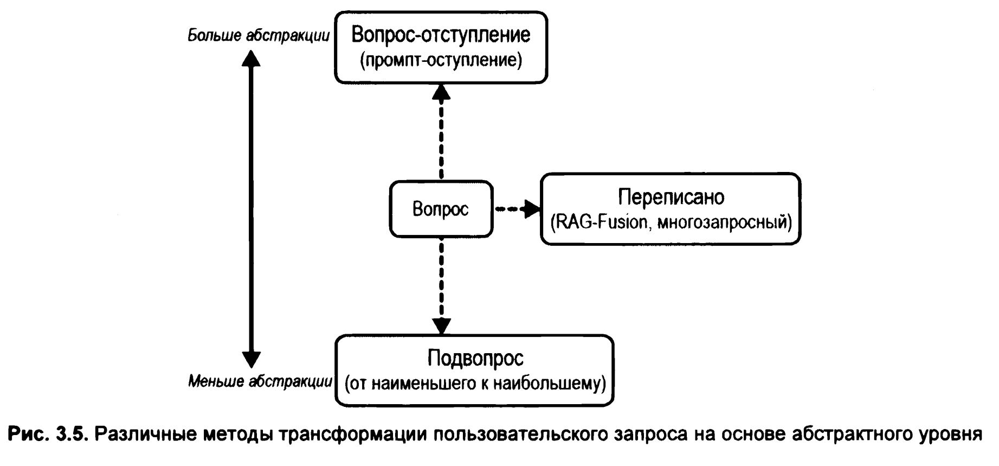
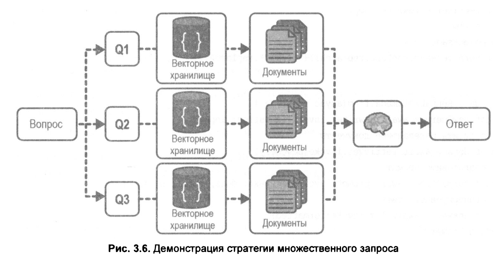
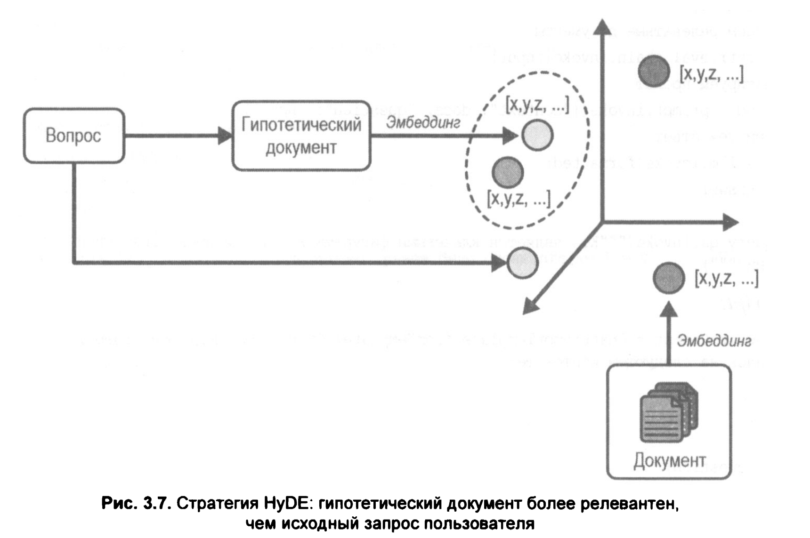
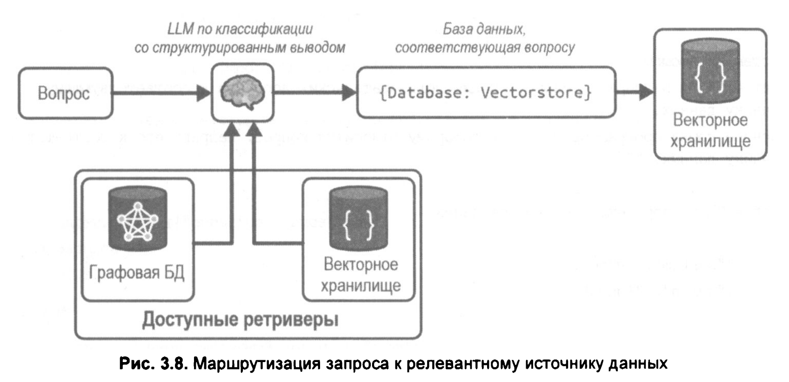
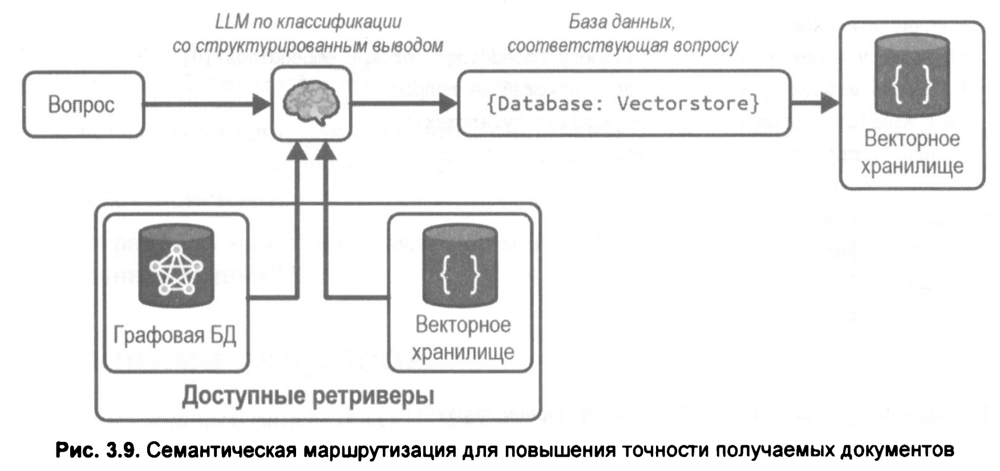

# 03. Генерация с дополнением поиском, часть II: "чат" с вашими данными

```shell
$ docker run \
    --name pgvector-container \
    -e POSTGRES_USER=langchain \
    -e POSTGRES_PASSWORD=langchain \
    -e POSTGRES_DB=langchain \
    -p 6024:5432 \
    -d pgvector/pgvector:pg16
```

<br/>

### 01. Извлечение релевантных документов


```shell
$ node ./a-basic-rag.js 
Документ успешно извлечен на основе поискового запроса по сходству (семантического поиска).:
 Полис: сердце греческого общества
В основе древнегреческой жизни был полис, город-государство, служивший основной политической и социальной единицей. Каждый полис был независимым образованием со своим правительством, законами и обычаями, что способствовало укреплению чувства общности и гражданской ответственности среди его граждан. Самые известные из этих городов-государств — Афины, Спарта, Коринф и Фивы — каждый имели свои особенности и структуры управления, что вносило свой вклад в разнообразный и динамичный греческий ландшафт.
Афины: колыбель демократии
Афины известны как родина демократии, где граждане непосредственно участвовали в процессах принятия решений. Собрания проводились регулярно, что позволяло гражданам мужского пола высказывать свое мнение и голосовать по законодательству, военным действиям и другим важным вопросам. Такое совместное управление способствовало активной гражданской активности и заложило основу для современных демократических систем.


AIMessage {
  "id": "chatcmpl_cache_bc5946d0-2e44-480f-a861-bec2b6ab8a49",
  "content": "Согласно предоставленному контексту, речь идет о следующих древнегреческих городах-государствах (полисах):\n\n*   **Афины**\n*   **Спарта**\n*   **Коринф**\n*   **Фивы**\n\n*(Примечание: В контексте также упоминается сам термин «полис» как общая основа жизни, но именно эти четыре города указаны как самые известные примеры).*",
  "additional_kwargs": {},
  "response_metadata": {
    "tokenUsage": {
      "completionTokens": 80,
      "totalTokens": 80
    },
    "finish_reason": "stop",
    "model_name": "auto"
  },
  "tool_calls": [],
  "invalid_tool_calls": [],
  "usage_metadata": {
    "output_tokens": 80,
    "total_tokens": 80,
    "input_token_details": {},
    "output_token_details": {}
  }
}


Выполняю повторный запуск. В целях повышения эффективности логика полностью капсулирована.

AIMessage {
  "id": "chatcmpl_cache_6c621671-9c3a-4d2e-978d-af138bcec1c8",
  "content": "Согласно предоставленному контексту, речь идет о следующих древнегреческих городах-государствах (полисах):\n\n*   **Афины**\n*   **Спарта**\n*   **Коринф**\n*   **Фивы**\n\n*(Примечание: В контексте также упоминается сам термин «полис» как общая основа жизни, но именно эти четыре города указаны как самые известные примеры).*",
  "additional_kwargs": {},
  "response_metadata": {
    "tokenUsage": {
      "completionTokens": 80,
      "totalTokens": 80
    },
    "finish_reason": "stop",
    "model_name": "auto"
  },
  "tool_calls": [],
  "invalid_tool_calls": [],
  "usage_metadata": {
    "output_tokens": 80,
    "total_tokens": 80,
    "input_token_details": {},
    "output_token_details": {}
  }
}
```

<br/>

**Генерация предсказаний модели на основе релевантных документов**


<br/>

### 02. Преобразование запроса



```shell
$ node ./b-rewrite.js 
{
  answer: AIMessage {
    "id": "chatcmpl-b8eed72cd479e5a8",
    "content": "В предоставленном контексте не упоминаются названия конкретных городов.\n\nТекст указывает только на то, что древнегреческое общество было сосредоточено вокруг **полиса** (или города-государства), который описывается как сердце греческого общества, но без перечисления отдельных городов.",
    "additional_kwargs": {
      "function_call": null
    },
    "response_metadata": {
      "tokenUsage": {
        "promptTokens": 543,
        "completionTokens": 69,
        "totalTokens": 612
      },
      "finish_reason": "stop",
      "model_name": "auto",
      "usage": {
        "prompt_tokens": 543,
        "total_tokens": 612,
        "completion_tokens": 69,
        "prompt_tokens_details": null,
        "completion_tokens_details": {
          "reasoning_tokens": 0
        }
      },
      "system_fingerprint": "vllm-0.30.0-4dc91a50"
    },
    "tool_calls": [],
    "invalid_tool_calls": [],
    "usage_metadata": {
      "output_tokens": 69,
      "input_tokens": 543,
      "total_tokens": 612,
      "input_token_details": {},
      "output_token_details": {
        "reasoning": 0
      }
    }
  },
  docs: [
    Document {
      pageContent: 'Глава 1: Жизнь в Древней Греции\n' +
        'Жизнь в Древней Греции представляла собой полотно, сотканное из богатых культурных, социальных и политических нитей, которые оставили неизгладимое наследие западной цивилизации. Древнегреческое общество, сосредоточенное вокруг полиса, или города-государства, способствовало уникальному сочетанию общественной жизни, интеллектуальных поисков и художественных инноваций. В этой главе рассматриваются многогранные аспекты повседневной жизни Древней Греции, исследуются социальная структура, образование, религия, экономика, а также вклад в искусство и архитектуру, которые определили эту замечательную цивилизацию.\n' +
        'Полис: сердце греческого общества',
      metadata: [Object],
      id: '716b52f0-a30e-4430-9abd-5d0b35e07363'
    },
    Document {
      pageContent: 'Глава 1: Жизнь в Древней Греции\n' +
        'Жизнь в Древней Греции представляла собой полотно, сотканное из богатых культурных, социальных и политических нитей, которые оставили неизгладимое наследие западной цивилизации. Древнегреческое общество, сосредоточенное вокруг полиса, или города-государства, способствовало уникальному сочетанию общественной жизни, интеллектуальных поисков и художественных инноваций. В этой главе рассматриваются многогранные аспекты повседневной жизни Древней Греции, исследуются социальная структура, образование, религия, экономика, а также вклад в искусство и архитектуру, которые определили эту замечательную цивилизацию.\n' +
        'Полис: сердце греческого общества',
      metadata: [Object],
      id: '88b6f371-b884-40b1-844f-52487e9d0f91'
    }
  ]
}


Вызовите модель снова с переписанным запросом.


AIMessage {
  "id": "chatcmpl-bf8d820d94e1be25",
  "content": "Согласно предоставленному контексту, речь идет о следующих древнегреческих городах-государствах (полисах):\n\n*   **Афины**\n*   **Спарта**\n*   **Коринф**\n*   **Фивы**\n\n*(Примечание: В контексте также упоминается сам термин «полис» как общая основа жизни, но именно эти четыре города указаны как самые известные примеры).*",
  "additional_kwargs": {
    "function_call": null
  },
  "response_metadata": {
    "tokenUsage": {
      "promptTokens": 659,
      "completionTokens": 99,
      "totalTokens": 758
    },
    "finish_reason": "stop",
    "model_name": "auto",
    "usage": {
      "prompt_tokens": 659,
      "total_tokens": 758,
      "completion_tokens": 99,
      "prompt_tokens_details": null,
      "completion_tokens_details": {
        "reasoning_tokens": 0
      }
    },
    "system_fingerprint": "vllm-0.30.0-4dc91a50"
  },
  "tool_calls": [],
  "invalid_tool_calls": [],
  "usage_metadata": {
    "output_tokens": 99,
    "input_tokens": 659,
    "total_tokens": 758,
    "input_token_details": {},
    "output_token_details": {
      "reasoning": 0
    }
  }
}
```


<br/>

### 03. Множественный запрос (Multi-Query Retrieval)

Стратегия множе­ственного запроса предлагает следующее:
LLM получает задание сгенерировать несколько запросов на основе исходного пользовательского запроса, затем каждый из них отправляется на параллельное извлечение данных, и уже объединенные ре­зультаты используются в качестве контекста в промпте для генерации финального ответа от модели.

<br/>



```shell
$ node ./c-multi-query.js 
Выполнение QA на основе множественных запросов

AIMessage {
  "id": "chatcmpl-b85444434f283cb4",
  "content": "В данной статье упоминаются следующие города-государства (полисы):\n\n*   Афины\n*   Спарта\n*   Коринф\n*   Фивы",
  "additional_kwargs": {
    "function_call": null
  },
  "response_metadata": {
    "tokenUsage": {
      "promptTokens": 342,
      "completionTokens": 40,
      "totalTokens": 382
    },
    "finish_reason": "stop",
    "model_name": "auto",
    "usage": {
      "prompt_tokens": 342,
      "total_tokens": 382,
      "completion_tokens": 40,
      "prompt_tokens_details": null,
      "completion_tokens_details": {
        "reasoning_tokens": 0
      }
    },
    "system_fingerprint": "vllm-0.30.0-4dc91a50"
  },
  "tool_calls": [],
  "invalid_tool_calls": [],
  "usage_metadata": {
    "output_tokens": 40,
    "input_tokens": 342,
    "total_tokens": 382,
    "input_token_details": {},
    "output_token_details": {
      "reasoning": 0
    }
  }
}
```

<br/>

### 04. Стратегия RAG-Fusion

Стратегия RAG-Fusion во многом схожа со стратегией многозапросного поиска (multi-query retrieval), за тем исключением, что в конце мы применяем шаг повторного ранжирования (reranking) ко всем полученным документам.

Этот шаг использует алгоритм Reciprocal Rank Fusion (RRF) — метод объединения результатов поиска путем сведения рангов из разных источников в единую итоговую таблицу ранжирования. Объединяя ранги документов, найденных по различным запросам, мы продвигаем самые релевантные документы наверх списка результатов.

```shell
$ node ./d-rag-fusion.js 
Running rag fusion

AIMessage {
  "id": "chatcmpl-998398828dad56e0",
  "content": "Основываясь на предоставленном контексте, в статье упоминаются следующие древнегреческие города-государства (полисы):\n\n1.  **Афины** — подробно описаны как родина демократии.\n2.  **Спарта**\n3.  **Коринф**\n4.  **Фивы**\n\nЭти города названы в тексте как «самые известные из этих городов-государств».",
  "additional_kwargs": {
    "function_call": null
  },
  "response_metadata": {
    "tokenUsage": {
      "promptTokens": 345,
      "completionTokens": 100,
      "totalTokens": 445
    },
    "finish_reason": "stop",
    "model_name": "auto",
    "usage": {
      "prompt_tokens": 345,
      "total_tokens": 445,
      "completion_tokens": 100,
      "prompt_tokens_details": null,
      "completion_tokens_details": {
        "reasoning_tokens": 0
      }
    },
    "system_fingerprint": "vllm-0.30.0-4dc91a50"
  },
  "tool_calls": [],
  "invalid_tool_calls": [],
  "usage_metadata": {
    "output_tokens": 100,
    "input_tokens": 345,
    "total_tokens": 445,
    "input_token_details": {},
    "output_token_details": {
      "reasoning": 0
    }
  }
}
```


<br/>

### 05. Эмбеддинг гипотетического документа

Стратегия эмбеддинга гипотетического документа (Hypothetical Document Embeddings (HyDE)) заключается в создании гипотетического документа на основе пользовательского запроса, преобразовании созданного документа в вектор и поиске релевантных документов по векторному сходству.

Суть этой стратегии такова: сгенерированный языковой моделью гипотетический документ, как правило, будет ближе по смыслу к действительно релевантным документам, чем сам исходный запрос пользователя

<br/>



<br/>

```shell
$ node ./e-hyde.js 
Running hyde

AIMessage {
  "id": "chatcmpl-ae3474b2f91a49b8",
  "content": "В предоставленном контексте речь идет исключительно об одном городе (полисе) — **Спарте**.\n\nВ тексте подробно описываются:\n*   Милитаристский характер общества.\n*   Социальная структура, управляемая двойной монархией и советом старейшин.\n*   Система воспитания и военной подготовки спартанских мужчин под названием «агоге».\n\nХотя заголовок содержит слово «Напротив» (что обычно противопоставляет Спарте Афины или другой полис), в самом предоставленном фрагменте текста **упоминается только Спарта**. Другие города в данном тексте не названы.",
  "additional_kwargs": {
    "function_call": null
  },
  "response_metadata": {
    "tokenUsage": {
      "promptTokens": 435,
      "completionTokens": 140,
      "totalTokens": 575
    },
    "finish_reason": "stop",
    "model_name": "auto",
    "usage": {
      "prompt_tokens": 435,
      "total_tokens": 575,
      "completion_tokens": 140,
      "prompt_tokens_details": null,
      "completion_tokens_details": {
        "reasoning_tokens": 0
      }
    },
    "system_fingerprint": "vllm-0.30.0-4dc91a50"
  },
  "tool_calls": [],
  "invalid_tool_calls": [],
  "usage_metadata": {
    "output_tokens": 140,
    "input_tokens": 435,
    "total_tokens": 575,
    "input_token_details": {},
    "output_token_details": {
      "reasoning": 0
    }
  }
}
```


<br/>

## Маршрутизация запросов

Хотя использовать единое векторное хранилище удобно, нужные данные могут находиться в разных типах источников — например, в реляционных базах данных или других векторных хранилищах.

Предположим, у вас есть два векторных хранилища: одно содержит документацию по LangChain для Python, а другое — для JavaScript. Когда пользователь задает вопрос, мы хотим направить его запрос в подходящее хранилище, чтобы получить релевантные документы.

<br/>

### 01. Логическая маршрутизация

При логической маршрутизации мы заранее обучаем LLM знанию о доступных источниках данных и позволяем ей самостоятельно определять, к какому источнику нужно обратиться, исходя из содержания запроса пользователя.

<br/>



```shell
$ node ./f-router.js 
Routing to:  { datasource: 'python_docs' }
```

<br/>

### 02. Семантическая маршрутизация

Семантическая маршрутизация (semantic routing) предполагает, что вы создаете эмбеддинги (векторные представления) различных промптов, представляющих разные источники данных, и сравниваете их с эмбеддингом пользовательского запроса. Далее с помощью поиска по векторному сходству выбирается наиболее близкий промпт.

<br/>


