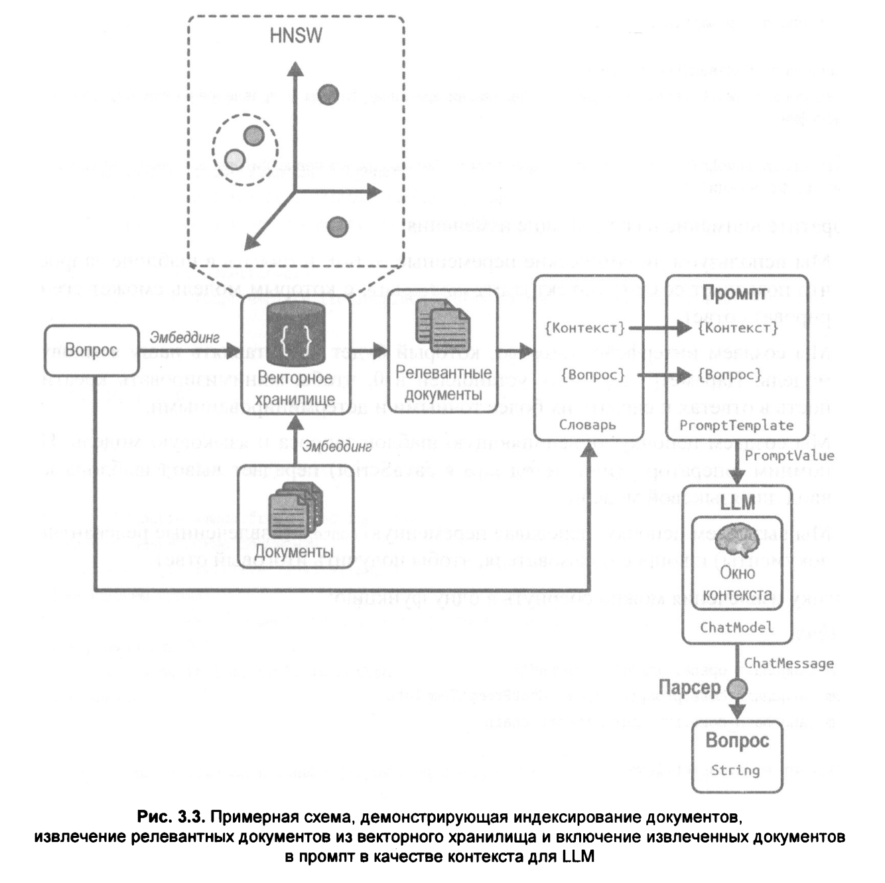

# 03. Генерация с дополнением поиском, часть II: "чат" с вашими данными

```shell
$ docker run \
    --name pgvector-container \
    -e POSTGRES_USER=langchain \
    -e POSTGRES_PASSWORD=langchain \
    -e POSTGRES_DB=langchain \
    -p 6024:5432 \
    -d pgvector/pgvector:pg16
```


<br/>

### Извлечение релевантных документов


```shell
$ node ./a-basic-rag.js 
Документ успешно извлечен на основе поискового запроса по сходству (семантического поиска).:
 Полис: сердце греческого общества
В основе древнегреческой жизни был полис, город-государство, служивший основной политической и социальной единицей. Каждый полис был независимым образованием со своим правительством, законами и обычаями, что способствовало укреплению чувства общности и гражданской ответственности среди его граждан. Самые известные из этих городов-государств — Афины, Спарта, Коринф и Фивы — каждый имели свои особенности и структуры управления, что вносило свой вклад в разнообразный и динамичный греческий ландшафт.
Афины: колыбель демократии
Афины известны как родина демократии, где граждане непосредственно участвовали в процессах принятия решений. Собрания проводились регулярно, что позволяло гражданам мужского пола высказывать свое мнение и голосовать по законодательству, военным действиям и другим важным вопросам. Такое совместное управление способствовало активной гражданской активности и заложило основу для современных демократических систем.


AIMessage {
  "id": "20261107162610faeb4049b4454ade",
  "content": "На основании предоставленного контекста, в статье упоминаются следующие древнегреческие города-государства (полисы):\n\n1.  **Афины**\n2.  **Спарта**\n3.  **Коринф**\n4.  **Фивы**\n\nЭто перечисление содержится в первом абзаце текста: *\"Самые известные из этих городов-государств — Афины, Спарта, Коринф и Фивы — каждый имели свои особенности и структуры управления...\"*",
  "additional_kwargs": {},
  "response_metadata": {
    "tokenUsage": {
      "promptTokens": 633,
      "completionTokens": 394,
      "totalTokens": 1027
    },
    "finish_reason": "stop",
    "model_name": "glm-4.5-flash"
  },
  "tool_calls": [],
  "invalid_tool_calls": [],
  "usage_metadata": {
    "output_tokens": 394,
    "input_tokens": 633,
    "total_tokens": 1027,
    "input_token_details": {
      "cache_read": 4
    },
    "output_token_details": {}
  }
}


Выполняю повторный запуск. В целях повышения эффективности логика полностью капсулирована.

AIMessage {
  "id": "202611071626542fefca96be684def",
  "content": "На основании предоставленного контекста, в статье говорится о следующих городах-государствах (полисах):\n\n1.  **Афины**\n2.  **Спарта**\n3.  **Коринф**\n4.  **Фивы**\n\nЭти города названы в первом абзасте текста: \"*Самые известные из этих городов-государств — **Афины, Спарта, Коринф и Фивы** — каждый имели свои особенности и структуры управления...*\". Последующий абзац подробно раскрывает только Афины, но перечень всех четырех городов приведен в первом предложении.",
  "additional_kwargs": {},
  "response_metadata": {
    "tokenUsage": {
      "promptTokens": 633,
      "completionTokens": 418,
      "totalTokens": 1051
    },
    "finish_reason": "stop",
    "model_name": "glm-4.5-flash"
  },
  "tool_calls": [],
  "invalid_tool_calls": [],
  "usage_metadata": {
    "output_tokens": 418,
    "input_tokens": 633,
    "total_tokens": 1051,
    "input_token_details": {
      "cache_read": 632
    },
    "output_token_details": {}
  }
}
```

<br/>

### Генерация предсказаний модели на основе релевантных документов



```shell
$ node ./b-rewrite.js 
{
  answer: AIMessage {
    "id": "202611071724538f6b46eb124f48ae",
    "content": "На основании предоставленного контекста, **в тексте не упоминаются конкретные названия городов.** \n\nВ фрагментах говорится о **полисах** (города-государства) как **основном структурном элементе греческого общества** (\"Древнегреческое общество, сосредоточенное вокруг полиса, или города-государства\"). Полис подчеркивается как \"сердце греческого общества\".\n\n**Вывод:** В данных отрывках речи идет о **полисах как категории городов** (Афины, Спарта, Коринф и т.д.), но **не называются конкретные города**. Если контекст расширен и содержит дальнейшие главы или разделы, именно там могут появиться примеры конкретных полисов (например, Афины как центр философии, Спарта как военное государство и т.д.). Однако в **представленном фрагменте** (Глава 1) таких деталей нет.",
    "additional_kwargs": {},
    "response_metadata": {
      "tokenUsage": {
        "promptTokens": 545,
        "completionTokens": 551,
        "totalTokens": 1096
      },
      "finish_reason": "stop",
      "model_name": "glm-4.5-flash"
    },
    "tool_calls": [],
    "invalid_tool_calls": [],
    "usage_metadata": {
      "output_tokens": 551,
      "input_tokens": 545,
      "total_tokens": 1096,
      "input_token_details": {
        "cache_read": 4
      },
      "output_token_details": {}
    }
  },
  docs: [
    Document {
      pageContent: 'Глава 1: Жизнь в Древней Греции\n' +
        'Жизнь в Древней Греции представляла собой полотно, сотканное из богатых культурных, социальных и политических нитей, которые оставили неизгладимое наследие западной цивилизации. Древнегреческое общество, сосредоточенное вокруг полиса, или города-государства, способствовало уникальному сочетанию общественной жизни, интеллектуальных поисков и художественных инноваций. В этой главе рассматриваются многогранные аспекты повседневной жизни Древней Греции, исследуются социальная структура, образование, религия, экономика, а также вклад в искусство и архитектуру, которые определили эту замечательную цивилизацию.\n' +
        'Полис: сердце греческого общества',
      metadata: [Object],
      id: '716b52f0-a30e-4430-9abd-5d0b35e07363'
    },
    Document {
      pageContent: 'Глава 1: Жизнь в Древней Греции\n' +
        'Жизнь в Древней Греции представляла собой полотно, сотканное из богатых культурных, социальных и политических нитей, которые оставили неизгладимое наследие западной цивилизации. Древнегреческое общество, сосредоточенное вокруг полиса, или города-государства, способствовало уникальному сочетанию общественной жизни, интеллектуальных поисков и художественных инноваций. В этой главе рассматриваются многогранные аспекты повседневной жизни Древней Греции, исследуются социальная структура, образование, религия, экономика, а также вклад в искусство и архитектуру, которые определили эту замечательную цивилизацию.\n' +
        'Полис: сердце греческого общества',
      metadata: [Object],
      id: '88b6f371-b884-40b1-844f-52487e9d0f91'
    }
  ]
}


Вызовите модель снова с переписанным запросом.


AIMessage {
  "id": "20261107172647e8f6223887af4625",
  "content": "На основе предоставленного контекста, в статье **упоминается только один тип городов - \"полисы\" (города-государства)**. Конкретные названия городов **не приводятся** в данном отрывке.\n\nВот что говорится о городах:\n1.  **Древнегреческое общество было сосредоточено вокруг полиса**.\n2.  Полис представлял **\"сердце греческого общества\"**.\n3.  Именно围绕着 полиса развивалась уникальная комбинация общественной жизни, интеллектуальных исканий и художественных новаций.\n\n**Вывод:** В данном фрагменте речь идет **о полисах как центральном элементе древнегреческой цивилизации**, но **нет конкретных примеров названий городов** (Афины, Спарта, Коринф и т.д.).",
  "additional_kwargs": {},
  "response_metadata": {
    "tokenUsage": {
      "promptTokens": 545,
      "completionTokens": 518,
      "totalTokens": 1063
    },
    "finish_reason": "stop",
    "model_name": "glm-4.5-flash"
  },
  "tool_calls": [],
  "invalid_tool_calls": [],
  "usage_metadata": {
    "output_tokens": 518,
    "input_tokens": 545,
    "total_tokens": 1063,
    "input_token_details": {
      "cache_read": 544
    },
    "output_token_details": {}
  }
}
```


<br/>

### Преобразование запроса

```shell
$ node ./c-multi-query.js 
Выполнение QA на основе множественных запросов

AIMessage {
  "id": "chatcmpl-b85444434f283cb4",
  "content": "В данной статье упоминаются следующие города-государства (полисы):\n\n*   Афины\n*   Спарта\n*   Коринф\n*   Фивы",
  "additional_kwargs": {
    "function_call": null
  },
  "response_metadata": {
    "tokenUsage": {
      "promptTokens": 342,
      "completionTokens": 40,
      "totalTokens": 382
    },
    "finish_reason": "stop",
    "model_name": "auto",
    "usage": {
      "prompt_tokens": 342,
      "total_tokens": 382,
      "completion_tokens": 40,
      "prompt_tokens_details": null,
      "completion_tokens_details": {
        "reasoning_tokens": 0
      }
    },
    "system_fingerprint": "vllm-0.30.0-4dc91a50"
  },
  "tool_calls": [],
  "invalid_tool_calls": [],
  "usage_metadata": {
    "output_tokens": 40,
    "input_tokens": 342,
    "total_tokens": 382,
    "input_token_details": {},
    "output_token_details": {
      "reasoning": 0
    }
  }
}
```
