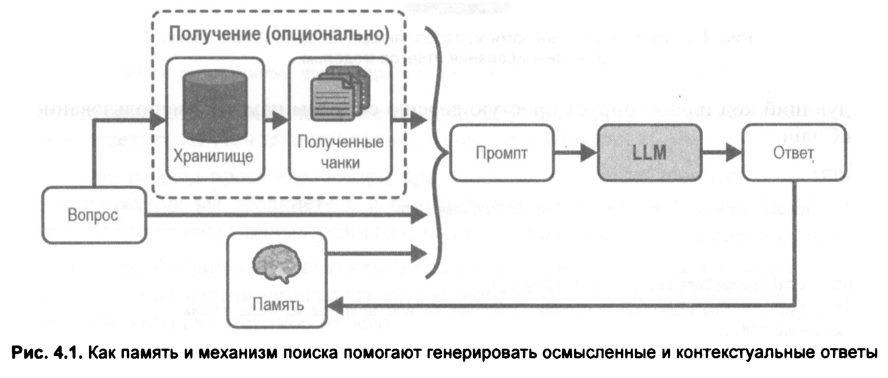
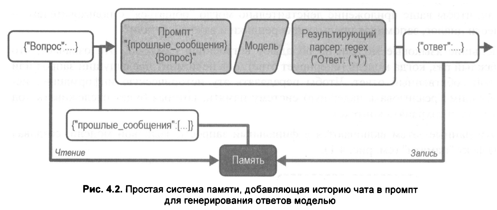

# 04. Добавляем долгосрочную память чат-боту с помощью LangGraph

<br/>



<br/>



<br/>

```shell
$ node ./a-simple-memory.js 
Я перевел ваше предложение "I love programming" на русский язык.

Перевод: **Я люблю программировать.**

Если вы имели в виду что-то другое или хотите уточнить контекст, пожалуйста, дайте знать! 😊
```

<br/>

## Знакомство с LangGraph
