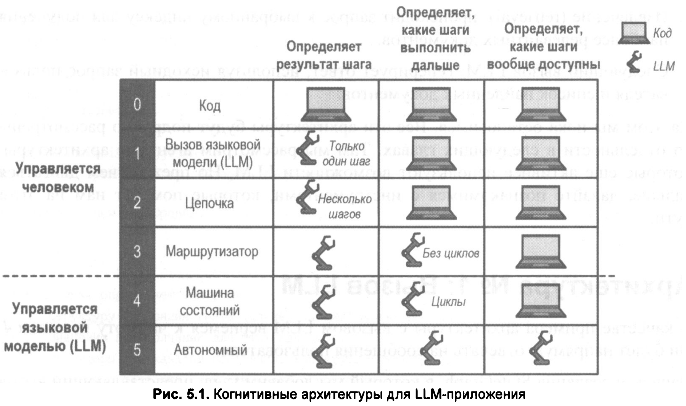

# 05. Когнитивные архитектуры с LangGraph

Применительно к LLM когнитивная архитектура — это по сути рецепты, или схема шагов, которые должно выполнять приложение на основе LLM. 
Примером шага может быть, скажем, извлечение релевантных документов (RAG) или вызов модели с промптом в стиле "цепочки размышлений" (chain-of-thought).

<br/>



<br/>

### Архитектура № 1: Вызов LLM

В качестве примера архитектуры с вызовом LLM вернемся к чат-боту. Он будет напрямую отвечать на сообщения пользователя.

```shell
$ node ./a-chatbot.js 
{
  chatbot: {
    messages: AIMessage {
      "id": "chatcmpl-ae26099592bd2fd2",
      "content": "Привет! Чем могу помочь?",
      "additional_kwargs": {
        "function_call": null
      },
      "response_metadata": {
        "tokenUsage": {
          "promptTokens": 16,
          "completionTokens": 9,
          "totalTokens": 25
        },
        "finish_reason": "stop",
        "model_name": "auto",
        "usage": {
          "prompt_tokens": 16,
          "total_tokens": 25,
          "completion_tokens": 9,
          "prompt_tokens_details": null,
          "completion_tokens_details": {
            "reasoning_tokens": 0
          }
        },
        "system_fingerprint": "vllm-0.30.0-4dc91a50"
      },
      "tool_calls": [],
      "invalid_tool_calls": [],
      "usage_metadata": {
        "output_tokens": 9,
        "input_tokens": 16,
        "total_tokens": 25,
        "input_token_details": {},
        "output_token_details": {
          "reasoning": 0
        }
      }
    }
  }
}
```

<br/>

### Архитектура No 2: Цепочка


Цепочка (chain) развивает предыдущую идею, добавляя вызовы LLM, идущие друг за другом в заранее заданной последовательности (т. е. при каждом запуске приложения выполняется один и тот же порядок вызовов LLM, хотя входные данные и результаты могут отличаться).

Рассмотрим в качестве примера приложение "текст в SQL", получающее от пользователя на естественном языке описание того, какой запрос к базе данных нужно сделать. Ранее мы упоминали, что такую задачу можно решить одним вызовом LLM, сгенерировав SQL-запрос. Однако мы можем построить более сложное приложение, если будем использовать несколько вызовов LLM подряд. Некоторые авторы называют такой подход инженерией потоков (flow engineering).

Опишем этот процесс словами:

1. Первый вызов LLM — генерирует SQL-запрос на основе пользовательского запроса на естественном языке и описание структуры базы данных, предоставленного разработчиком.
   
2. Второй вызов LLM — создает понятное для неспециалиста объяснение сгенерированного SQL-запроса, позволяющее пользователю понять, соответствует ли запрос его намерению.

```shell
$ s$ node ./b-sql-generator.js 
{
  messages: [
    HumanMessage {
      "id": "c2cb3345-be5c-4fa0-b6de-eaeb81b6912a",
      "content": "Каков общий объем продаж каждого продукта?",
      "additional_kwargs": {},
      "response_metadata": {}
    },
    AIMessage {
      "id": "chatcmpl-a4b975bff600d661",
      "content": "```sql\nSELECT \n    product_id,\n    product_name,\n    SUM(sales_amount) AS total_sales\nFROM \n    sales\nGROUP BY \n    product_id, product_name\nORDER BY \n    total_sales DESC;\n```",
      "additional_kwargs": {
        "function_call": null
      },
      "response_metadata": {
        "tokenUsage": {
          "promptTokens": 49,
          "completionTokens": 51,
          "totalTokens": 100
        },
        "finish_reason": "stop",
        "model_name": "auto",
        "usage": {
          "prompt_tokens": 49,
          "total_tokens": 100,
          "completion_tokens": 51,
          "prompt_tokens_details": null,
          "completion_tokens_details": {
            "reasoning_tokens": 0
          }
        },
        "system_fingerprint": "vllm-0.30.0-4dc91a50"
      },
      "tool_calls": [],
      "invalid_tool_calls": [],
      "usage_metadata": {
        "output_tokens": 51,
        "input_tokens": 49,
        "total_tokens": 100,
        "input_token_details": {},
        "output_token_details": {
          "reasoning": 0
        }
      }
    },
    AIMessage {
      "id": "chatcmpl-877b1e1e35965144",
      "content": "Давайте разберем этот запрос по шагам.\n\n### 1. Что делает запрос?\nЭтот SQL-запрос вычисляет **суммарный объем продаж** (в денежном выражении или в единицах, в зависимости от типа поля `sales_amount`) для каждого отдельного продукта.\n\n### 2. Разбор по частям:\n\n*   **`SELECT product_id, product_name, SUM(sales_amount) AS total_sales`**\n    *   Мы выбираем идентификатор продукта (`product_id`) и его название (`product_name`).\n    *   `SUM(sales_amount)` — это агрегатная функция, которая складывает все значения из столбца `sales_amount`.\n    *   `AS total_sales` — присваивает этому результату понятное имя `total_sales` (общие продажи), чтобы он был легко читаем в отчете.\n\n*   **`FROM sales`**\n    *   Данные берутся из таблицы `sales` (предполагается, что в этой таблице хранятся записи о продажах, где каждая строка — это одна сделка или транзакция).\n\n*   **`GROUP BY product_id, product_name`**\n    *   Это ключевая часть. Мы группируем данные по продукту.\n    *   Это означает: «Возьми все строки из таблицы `sales`, которые относятся к одному и тому же продукту, и объедини их в одну группу».\n    *   Затем функция `SUM` применяется к каждой такой группе отдельно.\n    *   *Примечание:* Группировка идет по `product_id`, а не только по имени, так как разные продукты могут иметь одинаковые названия, а `product_id` уникален.\n\n*   **`ORDER BY total_sales DESC`**\n    *   `ORDER BY` сортирует итоговый результат.\n    *   `total_sales DESC` означает сортировку по убыванию: продукты с наибольшим объемом продаж будут наверху списка, а с наименьшим — внизу.\n\n### 3. Пример результата:\n\n| product_id | product_name | total_sales |\n| :--- | :--- | :--- |\n| 101 | Laptop Pro | 500000 |\n| 105 | Wireless Mouse | 300000 |\n| 102 | Keyboard | 150000 |\n\n**Важное примечание:**\nЭтот запрос предполагает, что в таблице `sales` уже есть столбец `sales_amount`, содержащий сумму конкретной продажи. Если в таблице `sales` хранятся только количество проданных единиц (`quantity`) и цена (`unit_price`), то вместо `SUM(sales_amount)` нужно использовать `SUM(quantity * unit_price)`.",
      "additional_kwargs": {
        "function_call": null
      },
      "response_metadata": {
        "tokenUsage": {
          "promptTokens": 102,
          "completionTokens": 597,
          "totalTokens": 699
        },
        "finish_reason": "stop",
        "model_name": "auto",
        "usage": {
          "prompt_tokens": 102,
          "total_tokens": 699,
          "completion_tokens": 597,
          "prompt_tokens_details": null,
          "completion_tokens_details": {
            "reasoning_tokens": 0
          }
        },
        "system_fingerprint": "vllm-0.30.0-4dc91a50"
      },
      "tool_calls": [],
      "invalid_tool_calls": [],
      "usage_metadata": {
        "output_tokens": 597,
        "input_tokens": 102,
        "total_tokens": 699,
        "input_token_details": {},
        "output_token_details": {
          "reasoning": 0
        }
      }
    }
  ],
  user_query: 'Каков общий объем продаж каждого продукта?',
  sql_query: '```sql\n' +
    'SELECT \n' +
    '    product_id,\n' +
    '    product_name,\n' +
    '    SUM(sales_amount) AS total_sales\n' +
    'FROM \n' +
    '    sales\n' +
    'GROUP BY \n' +
    '    product_id, product_name\n' +
    'ORDER BY \n' +
    '    total_sales DESC;\n' +
    '```',
  sql_explanation: 'Давайте разберем этот запрос по шагам.\n' +
    '\n' +
    '### 1. Что делает запрос?\n' +
    'Этот SQL-запрос вычисляет **суммарный объем продаж** (в денежном выражении или в единицах, в зависимости от типа поля `sales_amount`) для каждого отдельного продукта.\n' +
    '\n' +
    '### 2. Разбор по частям:\n' +
    '\n' +
    '*   **`SELECT product_id, product_name, SUM(sales_amount) AS total_sales`**\n' +
    '    *   Мы выбираем идентификатор продукта (`product_id`) и его название (`product_name`).\n' +
    '    *   `SUM(sales_amount)` — это агрегатная функция, которая складывает все значения из столбца `sales_amount`.\n' +
    '    *   `AS total_sales` — присваивает этому результату понятное имя `total_sales` (общие продажи), чтобы он был легко читаем в отчете.\n' +
    '\n' +
    '*   **`FROM sales`**\n' +
    '    *   Данные берутся из таблицы `sales` (предполагается, что в этой таблице хранятся записи о продажах, где каждая строка — это одна сделка или транзакция).\n' +
    '\n' +
    '*   **`GROUP BY product_id, product_name`**\n' +
    '    *   Это ключевая часть. Мы группируем данные по продукту.\n' +
    '    *   Это означает: «Возьми все строки из таблицы `sales`, которые относятся к одному и тому же продукту, и объедини их в одну группу».\n' +
    '    *   Затем функция `SUM` применяется к каждой такой группе отдельно.\n' +
    '    *   *Примечание:* Группировка идет по `product_id`, а не только по имени, так как разные продукты могут иметь одинаковые названия, а `product_id` уникален.\n' +
    '\n' +
    '*   **`ORDER BY total_sales DESC`**\n' +
    '    *   `ORDER BY` сортирует итоговый результат.\n' +
    '    *   `total_sales DESC` означает сортировку по убыванию: продукты с наибольшим объемом продаж будут наверху списка, а с наименьшим — внизу.\n' +
    '\n' +
    '### 3. Пример результата:\n' +
    '\n' +
    '| product_id | product_name | total_sales |\n' +
    '| :--- | :--- | :--- |\n' +
    '| 101 | Laptop Pro | 500000 |\n' +
    '| 105 | Wireless Mouse | 300000 |\n' +
    '| 102 | Keyboard | 150000 |\n' +
    '\n' +
    '**Важное примечание:**\n' +
    'Этот запрос предполагает, что в таблице `sales` уже есть столбец `sales_amount`, содержащий сумму конкретной продажи. Если в таблице `sales` хранятся только количество проданных единиц (`quantity`) и цена (`unit_price`), то вместо `SUM(sales_amount)` нужно использовать `SUM(quantity * unit_price)`.'
}
```

<br/>

### Архитектура No 3: Маршрутизатор

Следующая архитектура движется вперед по шкале автономности: теперь LLM сам принимает решение, какой шаг выполнить дальше. В отличие от цепочечной архитектуры, где всегда выполняется фиксированная последовательность шагов (сколько бы их ни было), маршрутизатор работает иначе — он использует LLM для выбора одного из заранее определенных шагов.

Рассмотрим пример приложения RAG (Retrieval-Augmented Generation), работающего с несколькими индексами документов из разных областей знаний.

```shell
$ 
```

