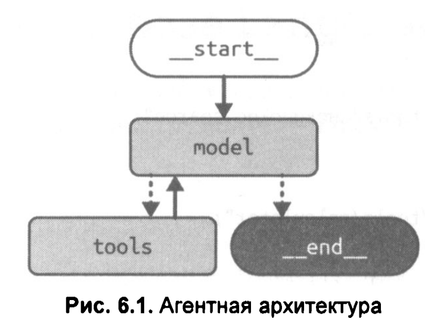
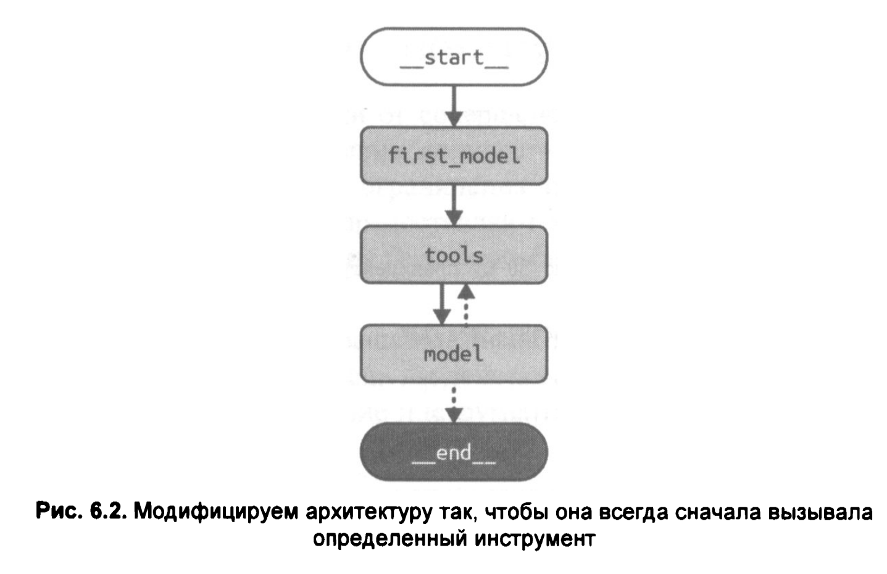
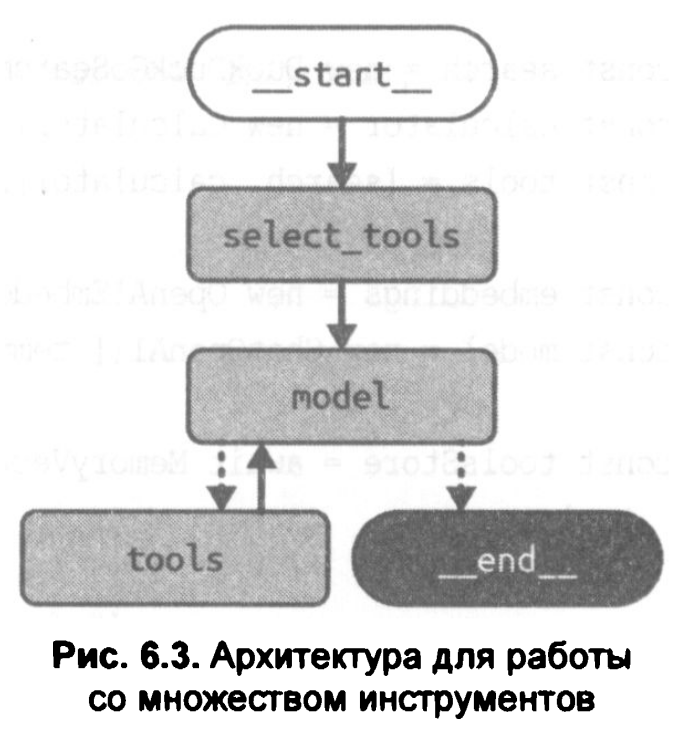

# Аrентная архитектура

LLM-приложение, обладающее агентной природой, — это приложение, которое использует языковую модель, чтобы выбирать один или несколько вариантов действия на основе текущего контекста (например, состояния мира или желаемого результата).

Такие способности обычно реализуются при сочетании двух приемов создания промптов:

**Вызов инструментов (Tool calling)**

Включение в промпт списка внешних функций, которыми LLM может воспользоваться (т. е. действий, которые она может выбрать), и указание, как оформлять выбор в выводе. 

**Цепочка рассуждений (Chain-of-thought)**

Исследователи выяснили, что LLM лучше справляются с задачами, когда получают инструкции "думать шаг за шагом" — т. е. разбивать сложную задачу на последовательность мелких шагов, что обычно реализуется либо через добавление явных указаний вроде "рассуждай поэтапно", либо с помощью примеров, в которых показано, как разбивается задача и решается по частям.

<br/>

### Цикл Plan-Do (планирование-действие)

Агентная архитектура отличается: циклом, управляемым LLM.

Любой программист знаком с понятием цикла. Под циклом мы подразумеваем конструкцию, при которой код выполняется многократно, пока не будет достигнуто определенное условие завершения (stop condition). В случае с агентом условие завершения контролируется самой языковой моделью — именно она решает, когда остановиться.

Ключевая особенность агентной архитектуры заключается в следующем: LLM не просто отвечает, а управляет процессом — выбирает действия, выполняет их, оценивает результат и решает, нужно ли продолжать.

Внутри цикла мы будем выполнять некую вариацию следующих шагов:

• планирование действия (или нескольких);
• выполнение запланированного действия.

Сила агентной архитектуры заключается в следующем: LLM получает свободу действий — она сама выбирает, какие шаги предпринять и когда остановиться. Задача — не только найти ответ, но и самостоятельно решить, сколько шагов потребуется для его получения.

Такая архитектура получила название ReAct (от Reasoning + Acting) и была впервые предложена Шанью Яо и др. 

<br/>

### 01. Создание агента на базе LangGraph

:warning: Код сильно поменялся из-за того, что DuckDuckGo писал сообщения о слишком большом количестве запросов и отказывается работать

:warning: GROQ справился. Vireonix нет.

:warning: Предустановленная функция toolsCondition из пакета @langchain/langgraph/prebuilt автоматически возвращает строку "__end__", если в сообщении от модели отсутствуют запросы на вызов инструментов.

<br/>

```shell
$ node ./a-basic-agent.js 
Zod field at `#/definitions/calculator/properties/input` uses `.optional()` without `.nullable()` which is not supported by the API. See: https://platform.openai.com/docs/guides/structured-outputs?api-mode=responses#all-fields-must-be-required
This will become an error in a future version of the SDK.
{
  model: {
    messages: [
      AIMessage {
        lc_serializable: true,
        lc_kwargs: {
          content: '',
          name: undefined,
          additional_kwargs: {
            function_call: undefined,
            tool_calls: [
              {
                id: 'fc_9ad0a52b-e891-4991-a046-ebaf892b81c3',
                type: 'function',
                function: {
                  name: 'duckduckgo-search',
                  arguments: '{"input":"when were Maya hieroglyphs first discovered"}'
                }
              }
            ]
          },
          response_metadata: {
            model_name: 'openai/gpt-oss-120b',
            usage: {
              queue_time: 0.313476653,
              prompt_tokens: 252,
              prompt_time: 0.010754297,
              completion_tokens: 196,
              completion_time: 0.416671089,
              total_tokens: 448,
              total_time: 0.427425386,
              completion_tokens_details: { reasoning_tokens: 158 }
            },
            system_fingerprint: 'fp_c652c0ffaa'
          },
          id: 'chatcmpl-2b708196-1e05-4faf-89ec-abff7b733b79',
          tool_calls: [
            {
              name: 'duckduckgo-search',
              args: { input: 'when were Maya hieroglyphs first discovered' },
              type: 'tool_call',
              id: 'fc_9ad0a52b-e891-4991-a046-ebaf892b81c3'
            }
          ],
          invalid_tool_calls: [],
          usage_metadata: {
            output_tokens: 196,
            input_tokens: 252,
            total_tokens: 448,
            input_token_details: { audio: undefined, cache_read: undefined },
            output_token_details: { audio: undefined, reasoning: 158 }
          }
        },
        lc_namespace: [ 'langchain_core', 'messages' ],
        content: '',
        name: undefined,
        additional_kwargs: {
          function_call: undefined,
          tool_calls: [
            {
              id: 'fc_9ad0a52b-e891-4991-a046-ebaf892b81c3',
              type: 'function',
              function: {
                name: 'duckduckgo-search',
                arguments: '{"input":"when were Maya hieroglyphs first discovered"}'
              }
            }
          ]
        },
        response_metadata: {
          tokenUsage: {
            promptTokens: 252,
            completionTokens: 196,
            totalTokens: 448
          },
          finish_reason: 'tool_calls',
          model_name: 'openai/gpt-oss-120b',
          usage: {
            queue_time: 0.313476653,
            prompt_tokens: 252,
            prompt_time: 0.010754297,
            completion_tokens: 196,
            completion_time: 0.416671089,
            total_tokens: 448,
            total_time: 0.427425386,
            completion_tokens_details: { reasoning_tokens: 158 }
          },
          system_fingerprint: 'fp_c652c0ffaa'
        },
        id: 'chatcmpl-2b708196-1e05-4faf-89ec-abff7b733b79',
        tool_calls: [
          {
            name: 'duckduckgo-search',
            args: { input: 'when were Maya hieroglyphs first discovered' },
            type: 'tool_call',
            id: 'fc_9ad0a52b-e891-4991-a046-ebaf892b81c3'
          }
        ],
        invalid_tool_calls: [],
        usage_metadata: {
          output_tokens: 196,
          input_tokens: 252,
          total_tokens: 448,
          input_token_details: { audio: undefined, cache_read: undefined },
          output_token_details: { audio: undefined, reasoning: 158 }
        }
      }
    ]
  }
}
{
  tools: {
    messages: [
      ToolMessage {
        lc_serializable: true,
        lc_kwargs: {
          content: 'Историческая справка: Первое подробное описание иероглифов майя европейцами (Диего де Ланда) произошло в 1566 году. Юрий Кнорозов успешно расшифровал письменность майя, опубликовав свою ключевую работу в 1952 году.',
          name: 'duckduckgo-search',
          tool_call_id: 'fc_9ad0a52b-e891-4991-a046-ebaf892b81c3',
          additional_kwargs: {},
          response_metadata: {},
          id: '61a029fb-3894-4435-a15a-6105cfc13d66'
        },
        lc_namespace: [ 'langchain_core', 'messages' ],
        content: 'Историческая справка: Первое подробное описание иероглифов майя европейцами (Диего де Ланда) произошло в 1566 году. Юрий Кнорозов успешно расшифровал письменность майя, опубликовав свою ключевую работу в 1952 году.',
        name: 'duckduckgo-search',
        additional_kwargs: {},
        response_metadata: {},
        id: '61a029fb-3894-4435-a15a-6105cfc13d66',
        lc_direct_tool_output: true,
        status: undefined,
        tool_call_id: 'fc_9ad0a52b-e891-4991-a046-ebaf892b81c3',
        metadata: undefined,
        artifact: undefined
      }
    ]
  }
}
{
  model: {
    messages: [
      AIMessage {
        lc_serializable: true,
        lc_kwargs: {
          content: 'Первое систематическое знакомство европейцев с майянскими иероглифами датируется 1566 годом (описание Диего де Ланды).  \n' +
            'Ключевая работа Юрия Кнорозова, в которой он представил успешную расшифровку майянского письма, была опубликована в 1952 году.\n' +
            '\n' +
            '**Временной промежуток между этими событиями:**  \n' +
            '\n' +
            '1952 – 1566 = **386 лет**.',
          name: undefined,
          additional_kwargs: { function_call: undefined, tool_calls: undefined },
          response_metadata: {
            model_name: 'openai/gpt-oss-120b',
            usage: {
              queue_time: 0.158306685,
              prompt_tokens: 357,
              prompt_time: 0.014051783,
              completion_tokens: 181,
              completion_time: 0.381349146,
              total_tokens: 538,
              total_time: 0.395400929,
              completion_tokens_details: { reasoning_tokens: 64 }
            },
            system_fingerprint: 'fp_c3da0d4bb9'
          },
          id: 'chatcmpl-92c8c823-7be2-492e-b3fd-2c9189960072',
          tool_calls: [],
          invalid_tool_calls: [],
          usage_metadata: {
            output_tokens: 181,
            input_tokens: 357,
            total_tokens: 538,
            input_token_details: { audio: undefined, cache_read: undefined },
            output_token_details: { audio: undefined, reasoning: 64 }
          }
        },
        lc_namespace: [ 'langchain_core', 'messages' ],
        content: 'Первое систематическое знакомство европейцев с майянскими иероглифами датируется 1566 годом (описание Диего де Ланды).  \n' +
          'Ключевая работа Юрия Кнорозова, в которой он представил успешную расшифровку майянского письма, была опубликована в 1952 году.\n' +
          '\n' +
          '**Временной промежуток между этими событиями:**  \n' +
          '\n' +
          '1952 – 1566 = **386 лет**.',
        name: undefined,
        additional_kwargs: { function_call: undefined, tool_calls: undefined },
        response_metadata: {
          tokenUsage: {
            promptTokens: 357,
            completionTokens: 181,
            totalTokens: 538
          },
          finish_reason: 'stop',
          model_name: 'openai/gpt-oss-120b',
          usage: {
            queue_time: 0.158306685,
            prompt_tokens: 357,
            prompt_time: 0.014051783,
            completion_tokens: 181,
            completion_time: 0.381349146,
            total_tokens: 538,
            total_time: 0.395400929,
            completion_tokens_details: { reasoning_tokens: 64 }
          },
          system_fingerprint: 'fp_c3da0d4bb9'
        },
        id: 'chatcmpl-92c8c823-7be2-492e-b3fd-2c9189960072',
        tool_calls: [],
        invalid_tool_calls: [],
        usage_metadata: {
          output_tokens: 181,
          input_tokens: 357,
          total_tokens: 538,
          input_token_details: { audio: undefined, cache_read: undefined },
          output_token_details: { audio: undefined, reasoning: 64 }
        }
      }
    ]
  }
}
```

<br/>



<br/>

Граф зацикливается между узлами модели и инструментов. То есть именно модель принимает решение о том, когда остановить выполнение — и это ключевая особенность агентной архитектуры. Каждый раз, когда вы строите цикл в LangGraph, скорее всего, потребуется условие завершения, чтобы определить, когда цикл должен завершиться.

<br/>

### 02. Всегда сначала вызываем инструмент

<br/>



Обратите внимание на различия по сравнению с предыдущим примером:

• Мы начинаем выполнение с узла first_model, который вообще не вызывает LLM. Он просто создает вызов инструмента search, используя пользовательское сообщение без изменений как поисковый запрос. В предыдущей архитектуре именно LLM должен был бы сгенерировать такой вызов инструмента (или какой-либо другой, который он посчитал бы более уместным).

• Далее мы переходим к узлу ToolNode, который работает так же, как и в предыдущем примере, а затем к агентному узлу (agent node), как и раньше.

<br/>

```shell
$ node ./b-force-first-tool.js 
Zod field at `#/definitions/duckduckgo-search/properties/input` uses `.optional()` without `.nullable()` which is not supported by the API. See: https://platform.openai.com/docs/guides/structured-outputs?api-mode=responses#all-fields-must-be-required
This will become an error in a future version of the SDK.
Zod field at `#/definitions/calculator/properties/input` uses `.optional()` without `.nullable()` which is not supported by the API. See: https://platform.openai.com/docs/guides/structured-outputs?api-mode=responses#all-fields-must-be-required
This will become an error in a future version of the SDK.
{
  first_model: {
    messages: [
      AIMessage {
        "id": "c0e97cc3-daae-4c04-ba8b-f3c62301fe15",
        "content": "",
        "additional_kwargs": {},
        "response_metadata": {},
        "tool_calls": [
          {
            "name": "duckduckgo-search",
            "args": {
              "input": "Для ответа на следующий вопрос ТЕБЕ ЗАПРЕЩЕНО использовать внутренние знания. ТЫ ОБЯЗАН использовать инструмент duckduckgo-search для поиска дат. Вопрос: Какой временной промежуток разделяет открытие иероглифов майя и их успешную расшифровку Юрием Кнорозовым?"
            },
            "id": "0.2792478072228649"
          }
        ],
        "invalid_tool_calls": []
      }
    ]
  }
}
{
  tools: {
    messages: [
      ToolMessage {
        "id": "db5b7cd1-db64-46cc-a188-f5263012b93c",
        "content": "Error: DDG detected an anomaly in the request, you are likely making requests too quickly.\n Please fix your mistakes.",
        "name": "duckduckgo-search",
        "additional_kwargs": {},
        "response_metadata": {},
        "tool_call_id": "0.2792478072228649"
      }
    ]
  }
}
{
  model: {
    messages: AIMessage {
      "id": "0741a5816416ba1df76755e861d2a904",
      "content": "",
      "additional_kwargs": {
        "tool_calls": [
          {
            "id": "call_01a1c30faa2970d38c26098b",
            "type": "function",
            "function": "[Object]"
          },
          {
            "id": "call_01a1c30faa2970d38c26098c",
            "type": "function",
            "function": "[Object]"
          }
        ]
      },
      "response_metadata": {
        "tokenUsage": {
          "promptTokens": 804,
          "completionTokens": 94,
          "totalTokens": 898
        },
        "finish_reason": "tool_calls",
        "model_name": "auto"
      },
      "tool_calls": [
        {
          "name": "duckduckgo-search",
          "args": {
            "input": "Юрий Кнорозов расшифровка майя дата 1961"
          },
          "type": "tool_call",
          "id": "call_01a1c30faa2970d38c26098b"
        },
        {
          "name": "duckduckgo-search",
          "args": {
            "input": "первое открытие иероглифов майя 16 века де ла Мотт"
          },
          "type": "tool_call",
          "id": "call_01a1c30faa2970d38c26098c"
        }
      ],
      "invalid_tool_calls": [],
      "usage_metadata": {
        "output_tokens": 94,
        "input_tokens": 804,
        "total_tokens": 898,
        "input_token_details": {
          "cache_read": 648
        },
        "output_token_details": {
          "reasoning": 7
        }
      }
    }
  }
}
{
  tools: {
    messages: [
      ToolMessage {
        "id": "5dfd741e-3402-4914-bb71-e5449f28c893",
        "content": "Error: DDG detected an anomaly in the request, you are likely making requests too quickly.\n Please fix your mistakes.",
        "name": "duckduckgo-search",
        "additional_kwargs": {},
        "response_metadata": {},
        "tool_call_id": "call_01a1c30faa2970d38c26098b"
      },
      ToolMessage {
        "id": "39bf87da-9218-49e3-a1ea-d526d5e05eff",
        "content": "Error: DDG detected an anomaly in the request, you are likely making requests too quickly.\n Please fix your mistakes.",
        "name": "duckduckgo-search",
        "additional_kwargs": {},
        "response_metadata": {},
        "tool_call_id": "call_01a1c30faa2970d38c26098c"
      }
    ]
  }
}
{
  model: {
    messages: AIMessage {
      "id": "0741a59f53af795c3c581641e71ceb68",
      "content": "",
      "additional_kwargs": {
        "tool_calls": [
          {
            "id": "call_01a1c30fc1727622a4dbb3b0",
            "type": "function",
            "function": "[Object]"
          }
        ]
      },
      "response_metadata": {
        "tokenUsage": {
          "promptTokens": 959,
          "completionTokens": 55,
          "totalTokens": 1014
        },
        "finish_reason": "tool_calls",
        "model_name": "auto"
      },
      "tool_calls": [
        {
          "name": "duckduckgo-search",
          "args": {
            "input": "Yuri Knorozov decipherment of Maya script 1961 date"
          },
          "type": "tool_call",
          "id": "call_01a1c30fc1727622a4dbb3b0"
        }
      ],
      "invalid_tool_calls": [],
      "usage_metadata": {
        "output_tokens": 55,
        "input_tokens": 959,
        "total_tokens": 1014,
        "input_token_details": {
          "cache_read": 657
        },
        "output_token_details": {
          "reasoning": 11
        }
      }
    }
  }
}
{
  tools: {
    messages: [
      ToolMessage {
        "id": "2ecb8ec3-894b-4802-bed6-3bf21676d864",
        "content": "Error: DDG detected an anomaly in the request, you are likely making requests too quickly.\n Please fix your mistakes.",
        "name": "duckduckgo-search",
        "additional_kwargs": {},
        "response_metadata": {},
        "tool_call_id": "call_01a1c30fc1727622a4dbb3b0"
      }
    ]
  }
}
```

<br/>

### 03. Работа с множеством инструментов

Когда LLM предоставляют множество инструментов (скажем, больше 10), качество планирования (т. е. способность выбрать правильный инстру­ мент) начинает снижаться.

Решение этой проблемы — сокращение числа инструментов, из которых модель может выбирать. Но что делать, если вы действительно хотите, чтобы модель могла использовать большое разнообразие инструментов в зависимости от пользовательских запросов?

Один из элегантных подходов — использовать этап RAG (Retrieval-Augmented Generation) для предварительного отбора наиболее релевантных инструментов для текущего запроса, а затем передать LLM только полученный поднабор, а не весь арсенал, что также поможет снизить стоимость вызова LLM (коммерческие модели, как правило, тарифицируются по длине запроса и ответа). С другой стороны, этап RAG вносит дополнительную задержку в работу приложения, поэтому его стоит использовать только при явном снижении производительности после добавления большего количества инструментов.

<br/>



<br/>

Это почти то же самое, что и обычная агентная архитектура. Единственное отличие в том, что перед входом в основной цикл агента мы сначала проходим через узел select_tools (выбор инструментов). После этого все работает так же, как и в обычной агентной архитектуре, которую мы рассматривали ранее.


<br/>

```shell
$ node ./c-many-tools.js 
{
  select_tools: { selected_tools: [ 'DuckDuckGoSearch', 'Calculator' ] }
}
Zod field at `#/definitions/duckduckgo-search/properties/input` uses `.optional()` without `.nullable()` which is not supported by the API. See: https://platform.openai.com/docs/guides/structured-outputs?api-mode=responses#all-fields-must-be-required
This will become an error in a future version of the SDK.
Zod field at `#/definitions/calculator/properties/input` uses `.optional()` without `.nullable()` which is not supported by the API. See: https://platform.openai.com/docs/guides/structured-outputs?api-mode=responses#all-fields-must-be-required
This will become an error in a future version of the SDK.
{
  model: {
    messages: AIMessage {
      "id": "0741aba3229af4352924b20754037833",
      "content": "",
      "additional_kwargs": {
        "tool_calls": [
          {
            "id": "call_01a1c3276881760ebdf7cdaa",
            "type": "function",
            "function": "[Object]"
          },
          {
            "id": "call_01a1c3276881760ebdf7cdab",
            "type": "function",
            "function": "[Object]"
          }
        ]
      },
      "response_metadata": {
        "tokenUsage": {
          "promptTokens": 645,
          "completionTokens": 883,
          "totalTokens": 1528
        },
        "finish_reason": "tool_calls",
        "model_name": "auto"
      },
      "tool_calls": [
        {
          "name": "duckduckgo-search",
          "args": {
            "input": "открытие иероглифов майя расшифровка Кнорозовым сколько лет спустя"
          },
          "type": "tool_call",
          "id": "call_01a1c3276881760ebdf7cdaa"
        },
        {
          "name": "duckduckgo-search",
          "args": {
            "input": "\"иероглифы майя\" \"открыты\" в каком году расшифрованы Кнорозов 1960"
          },
          "type": "tool_call",
          "id": "call_01a1c3276881760ebdf7cdab"
        }
      ],
      "invalid_tool_calls": [],
      "usage_metadata": {
        "output_tokens": 883,
        "input_tokens": 645,
        "total_tokens": 1528,
        "input_token_details": {
          "cache_read": 225
        },
        "output_token_details": {
          "reasoning": 776
        }
      }
    }
  }
}
{
  tools: {
    messages: [
      ToolMessage {
        "id": "61cc6247-043c-4326-ad87-0e03c2da1470",
        "content": "Error: DDG detected an anomaly in the request, you are likely making requests too quickly.\n Please fix your mistakes.",
        "name": "duckduckgo-search",
        "additional_kwargs": {},
        "response_metadata": {},
        "tool_call_id": "call_01a1c3276881760ebdf7cdaa"
      },
      ToolMessage {
        "id": "32a8db9e-96f7-4dbb-bcc7-596e0a8d98a3",
        "content": "Error: DDG detected an anomaly in the request, you are likely making requests too quickly.\n Please fix your mistakes.",
        "name": "duckduckgo-search",
        "additional_kwargs": {},
        "response_metadata": {},
        "tool_call_id": "call_01a1c3276881760ebdf7cdab"
      }
    ]
  }
}
Zod field at `#/definitions/duckduckgo-search/properties/input` uses `.optional()` without `.nullable()` which is not supported by the API. See: https://platform.openai.com/docs/guides/structured-outputs?api-mode=responses#all-fields-must-be-required
This will become an error in a future version of the SDK.
Zod field at `#/definitions/calculator/properties/input` uses `.optional()` without `.nullable()` which is not supported by the API. See: https://platform.openai.com/docs/guides/structured-outputs?api-mode=responses#all-fields-must-be-required
This will become an error in a future version of the SDK.
{
  model: {
    messages: AIMessage {
      "id": "0741abb447d0053d345fec61f8912ac4",
      "content": "",
      "additional_kwargs": {
        "tool_calls": [
          {
            "id": "call_01a1c327866f70d889689ad0",
            "type": "function",
            "function": "[Object]"
          }
        ]
      },
      "response_metadata": {
        "tokenUsage": {
          "promptTokens": 1595,
          "completionTokens": 73,
          "totalTokens": 1668
        },
        "finish_reason": "tool_calls",
        "model_name": "auto"
      },
      "tool_calls": [
        {
          "name": "duckduckgo-search",
          "args": {
            "input": "расшифровка иероглифов майя Кнорозов 1960 открытие иероглифов"
          },
          "type": "tool_call",
          "id": "call_01a1c327866f70d889689ad0"
        }
      ],
      "invalid_tool_calls": [],
      "usage_metadata": {
        "output_tokens": 73,
        "input_tokens": 1595,
        "total_tokens": 1668,
        "input_token_details": {
          "cache_read": 645
        },
        "output_token_details": {
          "reasoning": 15
        }
      }
    }
  }
}
{
  tools: {
    messages: [
      ToolMessage {
        "id": "9d66d712-2705-452f-8140-6872ed9af13f",
        "content": "Error: DDG detected an anomaly in the request, you are likely making requests too quickly.\n Please fix your mistakes.",
        "name": "duckduckgo-search",
        "additional_kwargs": {},
        "response_metadata": {},
        "tool_call_id": "call_01a1c327866f70d889689ad0"
      }
    ]
  }
}
Zod field at `#/definitions/duckduckgo-search/properties/input` uses `.optional()` without `.nullable()` which is not supported by the API. See: https://platform.openai.com/docs/guides/structured-outputs?api-mode=responses#all-fields-must-be-required
This will become an error in a future version of the SDK.
Zod field at `#/definitions/calculator/properties/input` uses `.optional()` without `.nullable()` which is not supported by the API. See: https://platform.openai.com/docs/guides/structured-outputs?api-mode=responses#all-fields-must-be-required
This will become an error in a future version of the SDK.
{
  model: {
    messages: AIMessage {
      "id": "0741abbcc426a7619e234dd233193b4f",
      "content": "",
      "additional_kwargs": {
        "tool_calls": [
          {
            "id": "call_01a1c327a189715ba636aa56",
            "type": "function",
            "function": "[Object]"
          }
        ]
      },
      "response_metadata": {
        "tokenUsage": {
          "promptTokens": 929,
          "completionTokens": 70,
          "totalTokens": 999
        },
        "finish_reason": "tool_calls",
        "model_name": "auto"
      },
      "tool_calls": [
        {
          "name": "duckduckgo-search",
          "args": {
            "input": "Maya hieroglyphs discovered year deciphered Yuri Knorozov 1960"
          },
          "type": "tool_call",
          "id": "call_01a1c327a189715ba636aa56"
        }
      ],
      "invalid_tool_calls": [],
      "usage_metadata": {
        "output_tokens": 70,
        "input_tokens": 929,
        "total_tokens": 999,
        "input_token_details": {
          "cache_read": 645
        },
        "output_token_details": {
          "reasoning": 25
        }
      }
    }
  }
}
{
  tools: {
    messages: [
      ToolMessage {
        "id": "cf148eec-96dc-4801-9345-5907d45dab75",
        "content": "Error: DDG detected an anomaly in the request, you are likely making requests too quickly.\n Please fix your mistakes.",
        "name": "duckduckgo-search",
        "additional_kwargs": {},
        "response_metadata": {},
        "tool_call_id": "call_01a1c327a189715ba636aa56"
      }
    ]
  }
}
Zod field at `#/definitions/duckduckgo-search/properties/input` uses `.optional()` without `.nullable()` which is not supported by the API. See: https://platform.openai.com/docs/guides/structured-outputs?api-mode=responses#all-fields-must-be-required
This will become an error in a future version of the SDK.
Zod field at `#/definitions/calculator/properties/input` uses `.optional()` without `.nullable()` which is not supported by the API. See: https://platform.openai.com/docs/guides/structured-outputs?api-mode=responses#all-fields-must-be-required
This will become an error in a future version of the SDK.
{
  model: {
    messages: AIMessage {
      "id": "0741abc32e3f41fa7f61b21607c1df0a",
      "content": "",
      "additional_kwargs": {
        "tool_calls": [
          {
            "id": "call_01a1c327be117438afb65476",
            "type": "function",
            "function": "[Object]"
          }
        ]
      },
      "response_metadata": {
        "tokenUsage": {
          "promptTokens": 1021,
          "completionTokens": 72,
          "totalTokens": 1093
        },
        "finish_reason": "tool_calls",
        "model_name": "auto"
      },
      "tool_calls": [
        {
          "name": "duckduckgo-search",
          "args": {
            "input": "иероглифы майя история открытие расшифровка"
          },
          "type": "tool_call",
          "id": "call_01a1c327be117438afb65476"
        }
      ],
      "invalid_tool_calls": [],
      "usage_metadata": {
        "output_tokens": 72,
        "input_tokens": 1021,
        "total_tokens": 1093,
        "input_token_details": {
          "cache_read": 818
        },
        "output_token_details": {
          "reasoning": 27
        }
      }
    }
  }
}
{
  tools: {
    messages: [
      ToolMessage {
        "id": "b0e3f977-0b30-48a0-ad6d-899271aec245",
        "content": "Error: DDG detected an anomaly in the request, you are likely making requests too quickly.\n Please fix your mistakes.",
        "name": "duckduckgo-search",
        "additional_kwargs": {},
        "response_metadata": {},
        "tool_call_id": "call_01a1c327be117438afb65476"
      }
    ]
  }
}
Zod field at `#/definitions/duckduckgo-search/properties/input` uses `.optional()` without `.nullable()` which is not supported by the API. See: https://platform.openai.com/docs/guides/structured-outputs?api-mode=responses#all-fields-must-be-required
This will become an error in a future version of the SDK.
Zod field at `#/definitions/calculator/properties/input` uses `.optional()` without `.nullable()` which is not supported by the API. See: https://platform.openai.com/docs/guides/structured-outputs?api-mode=responses#all-fields-must-be-required
This will become an error in a future version of the SDK.
{
  model: {
    messages: AIMessage {
      "id": "0741abcaf394826332fcb87e086d745e",
      "content": "",
      "additional_kwargs": {
        "tool_calls": [
          {
            "id": "call_01a1c327e48776a1a9de1733",
            "type": "function",
            "function": "[Object]"
          }
        ]
      },
      "response_metadata": {
        "tokenUsage": {
          "promptTokens": 1105,
          "completionTokens": 46,
          "totalTokens": 1151
        },
        "finish_reason": "tool_calls",
        "model_name": "auto"
      },
      "tool_calls": [
        {
          "name": "calculator",
          "args": {
            "input": "1960 - 1779"
          },
          "type": "tool_call",
          "id": "call_01a1c327e48776a1a9de1733"
        }
      ],
      "invalid_tool_calls": [],
      "usage_metadata": {
        "output_tokens": 46,
        "input_tokens": 1105,
        "total_tokens": 1151,
        "input_token_details": {
          "cache_read": 913
        },
        "output_token_details": {
          "reasoning": 14
        }
      }
    }
  }
}
{
  tools: {
    messages: [
      ToolMessage {
        "id": "bda2c54d-0d4f-4467-83ed-13aa2ac3048f",
        "content": "181",
        "name": "calculator",
        "additional_kwargs": {},
        "response_metadata": {},
        "tool_call_id": "call_01a1c327e48776a1a9de1733"
      }
    ]
  }
}
Zod field at `#/definitions/duckduckgo-search/properties/input` uses `.optional()` without `.nullable()` which is not supported by the API. See: https://platform.openai.com/docs/guides/structured-outputs?api-mode=responses#all-fields-must-be-required
This will become an error in a future version of the SDK.
Zod field at `#/definitions/calculator/properties/input` uses `.optional()` without `.nullable()` which is not supported by the API. See: https://platform.openai.com/docs/guides/structured-outputs?api-mode=responses#all-fields-must-be-required
This will become an error in a future version of the SDK.
```

:warning: В данном коде выбор происходит из 2 инструментов.
