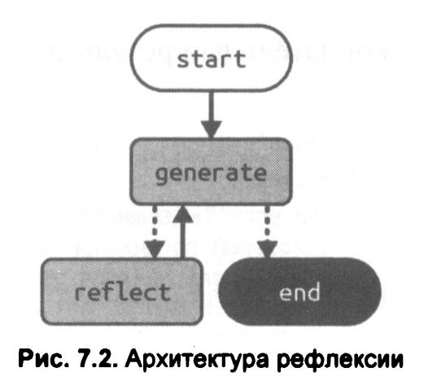
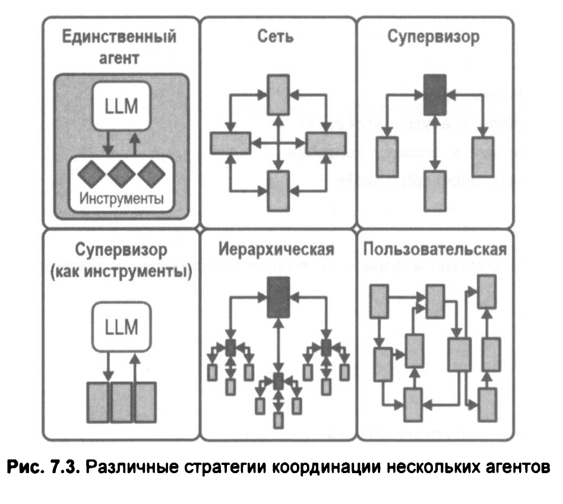

# 07. Агентная архитектура. Продолжение

В этой главе мы обсудим два расширения агентной архитектуры, позволяющих улучшить производительность в ряде сценариев:

* **Рефлексия** - Вдохновляясь человеческими моделями мышления, мы даем LLM-приложению возможнось анализировать собственные предыдущие ответы и принятые решения, а также запоминать выводы, сделанные в процессе такой саморефлексии.
* **Мультиагентность** - Подобно тому как команда может достичь большего, чем один человек, так и некоторые задачи эффективнее решаются несколькими LLM-агентами, работающими сообща.

<br/>

## 01. Рефлексия

Мы реализуем рефлексию в виде графа, состоящего из двух узлов: generate и reflect. Поставим задачу нашему графу отвечать за написание эссе из трех абзацев. Узел generate будет создавать или редактировать черновики эссе, а узел reflect — генерировать критику, на основании которой будет производиться следующая правка.

Мы запустим этот цикл фиксированное количество раз, но возможна и другая вариация, при которой именно узел reflect будет решать, когда пора остановиться.

<br/>



```shell
$ node ./a-reflection.js 

New message: Творчество группы «Король и шут» представляет собой уникальный синтез фолк-рока и литературной поэзи ...

New message: **Оценка эссе**

Ваш текст‑эссе о влиянии мифов и сказок на творчество группы «Король и шут» получил ...

New message: Творчество группы «Король и шут» представляет собой синтез фолк-рока и поэзии, где мифологические ар ...

New message: ## Критика текущего варианта эссе  

| Критерий | Оценка | Что удалось | Что требует доработки |
|-- ...

New message: Творчество группы «Король и шут» представляет собой синтез фолк-рока и поэтического нарратива, где м ...

New message: ## Критика представленного эссе  

| Критерий | Оценка | Что удалось | Что требует доработки |
|---- ...

New message: Творчество группы «Король и шут» представляет собой синтез фолк-рока и поэтического нарратива, где м ...
```


<br/>

### Подграфы в LangGraph

Подграфы - это графы, используемые как часть другого графа.

Существуют два способа добавить узлы-подграфы в родительский граф:

* **Добавить узел, который напрямую вызывает подграф** - Подходит, когда родительский граф и подграф используют одинаковые ключи состояния, а вам не нужно преобразовывать состояние на входе или выходе.
* **Добавить узел с функцией, вызывающей подграф** - Полезно, если у родительского граф и подграфа разные схемы состояния и необходимо преобразовать состояние до или после вызова подграфа.

<br/>

#### Прямой вызов подграфа

Самый простой способ создать узлы-подграфы - это напрямую прикрепить под­граф как узел. При этом важно, чтобы родительский граф и подграф использовали одни и те же ключи состояния, поскольку именно через них будет происходить об­мен данными

<br/>

```shell
$ node ./b-subgraph-direct.js 
Result: {"foo":"hellobar"}
```

<br/>

#### Вызов подграфа с помощью функции

В некоторых случаях может потребоваться определить подграф с совершенно иной схемой состояния. В таком случае можно создать узел с функцией, которая вызывает подграф. Эта функция должна будет:

• преобразовать входное (родительское) состояние в состояние, подходящее для подграфа, перед его вызовом;  
• затем преобразовать результаты работы подграфа обратно в состояние родительского графа перед возвратом обновленного состояния из узла.


```shell
$ node ./c-subgraph-function.js 
Result: {"foo":"hellobaz"}
```

<br/>

## 02. Архитектура с несколькими агентами

По мере того как агенты на базе LLM становятся более сложными или универсальными, начинают проявляться различные проблемы, влияющие на их производительность, например:

• Агенту предоставляется слишком много инструментов, и он принимает неудачные решения, выбирая, какой инструмент использовать следующим.

• Контекст становится слишком сложным для одного агента — т. е. размер промпта и количество упомянутых в нем объектов превышает возможности используемой модели.

• Вы хотите использовать специализированную подсистему для конкретной задачи, например: планирование, исследование, решение математических задач и т. д.

Чтобы справиться с этими проблемами, можно разбить приложение на несколько небольших, независимых агентов и объединить их в мультиагентную систему. Эти независимые агенты могут быть как простыми — например, состоящими только из промпта и вызова LLM, — так и сложными, например агентами ReAct

<br/>



**Сеть (Network)**  
Каждый агент может общаться с любым другим агентом. Любой агент может определить, какой агент будет выполняться следующим.

**Супервизор (Supervisor)**  
Каждый агент взаимодействует только с одним агентом — супервизором. Агент-супервизор принимает решение, какой агент (или агенты) должен быть вызван следующим. Частным случаем такой архитектуры является реализация супервизора в виде вызова LLM с инструментами.

**Иерархия (Hierarchical)**  
Мультиагентная система может быть определена с родительским супервизором. Такое обобщение архитектуры супервизора позволяет реализовать более сложные потоки управления.

**Пользовательский мультиагентный рабочий процесс (Custom multi-agent workflow)**  
Каждый агент взаимодействует только с ограниченным набором других агентов. Некоторые части потока являются детерминированными, при этом только определенные агенты могут решать, какие другие агенты будут вызваны далее.

