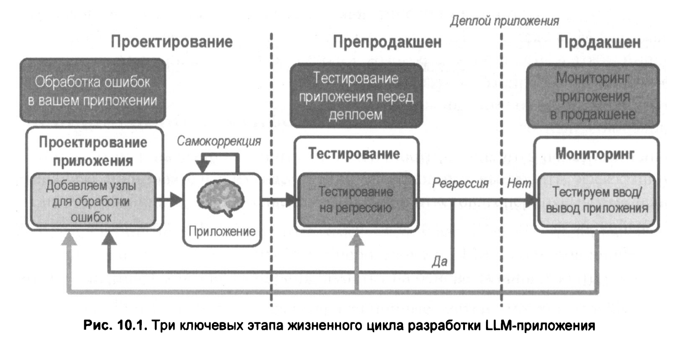

# 10. Тестирование: оценка, мониторинг и постоянное улучшение

 

## Методы тестирования на этапах жизненного цикла разработки LLМ-приложения

 

#### Проектирование

На этом этапе тесты выполняются непосредственно в рамках вашего приложения. Это могут быть утверждения (assertions), которые срабатывают во время выполнения и передают информацию об ошибках обратно в LLM для самокоррекции. Цель тестирования здесь — выявление и обработка ошибок до того, как они затронут пользователей.

#### Предпродакшен (предрелиз)

На этом этапе тесты запускаются перед развертыванием в рабочей среде. Их задача — выявить и устранить регрессии до того, как приложение попадет в руки реальных пользователей.

#### Продакшен (релиз)

На этом этапе тесты выполняются уже в рабочей среде, когда приложение активно используется. Их задача — отслеживать возникающие ошибки и выявлять проблемы, которые затем можно устранить, вернувшись к этапу проектирования или предпродакшена.
