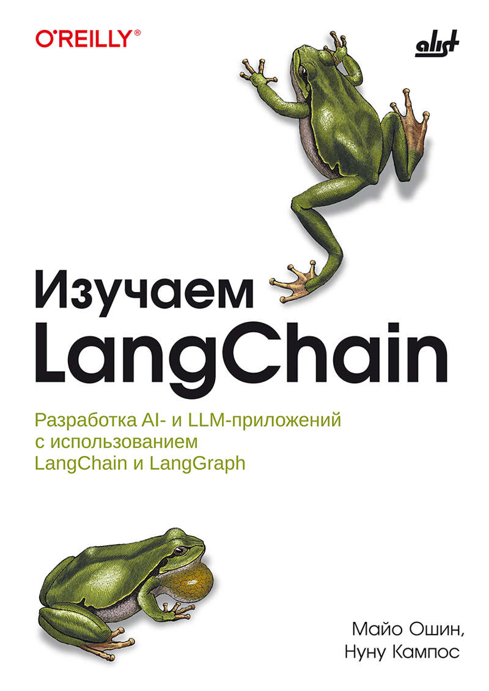

# [Книга][Ошин Майо, Кампос Нуну] Изучаем LangChain: разработка AI- и LLM-приложений с использованием LangChain и LangGraph [RUS, 2026]

[Book][Mayo Oshin, Nuno Campos] Learning LangChain: Building AI and LLM Applications with LangChain and LangGraph [ENG, 2025]

**Оригинальный код книги:**  
https://github.com/langchain-ai/learning-langchain

 

Практическое руководство по изучению LangChain и LangGraph для создания готовых к эксплуатации AI- и LLM-приложений. Рассмотрены основы работы с большими языковыми моделями (LLM), извлечение и индексация данных для генерации, дополненной поиском (retrieval-augmented generation, RAG), организация памяти чат-ботов через StateGraph. Детально разобраны когнитивные архитектуры (цепочки, маршрутизаторы, агентные циклы «планирование-действие»), построение многомодульных и мультиагентных систем. Приведены паттерны эффективного использования LLM: структурированный вывод, потоковая передача, режимы с участием человека. Отдельные главы посвящены развертыванию созданных приложений на платформе LangGraph — конфигурации, локальному тестированию, работе со студией LangGraph, а также комплексной оценке приложений: трассировке и сбору обратной связи в рабочей среде. .Книга предлагает работающий код, примеры оптимизации индексации и приемы трансформации запросов.

 

:triangular_flag_on_post: Оригинальное репо книги переведено в архив более года назад! :triangular_flag_on_post: 

 

### Оглавление:

<ul>
  <li>:white_check_mark: :book: :hammer_and_wrench: 01. Основы LLM с LangChain</li>
  <li>:white_check_mark: :book: :hammer_and_wrench:  02. Генерация с дополнением поиском, часть I: индексация ваших данных</li>
  <li>▶️ 03. Генерация с дополнением поиском, часть II: "чат" с вашими данными</li>
  <li>:pause_button: 04. Добавляем долгосрочную память чат-боту с помощью LangGraph</li>
  <li>:pause_button: 05. Когнитивные архитектуры с LangGraph</li>
  <li>:pause_button: 06. Агентная архитектура</li>
  <li>:pause_button: 07. Агентная архитектура. Продолжение</li>
  <li>:pause_button: 08. Паттерны для максимально эффективного использования LLM</li>
  <li>:pause_button: 09. Развертывание: запуск вашего AI-приложения в продакшен</li>
  <li>:pause_button: 10. Тестирование: оценка, мониторинг и постоянное улучшение</li>
  <li>:pause_button: 11. Разработка приложений с LLM</li>
</ul>

 

## Чем пользуюсь:

### [Vireonix] [Qwen] Free AI for chat, apps, and agents. Бесплатно, но с ограничениями.
https://vireonix.ai/

### [][GLM] glm-4.5-flash и glm-4.7-flash. Бесплатно, но с ограничениями.
https://z.ai/model-api

### [Groq + AmneziaVPN] openai/gpt-oss-120b. Бесплатно, но с ограничениями.
https://console.groq.com/

### [Openrouter + AmneziaVPN]. Бесплатно, но с ограничениями.
https://Openrouter.ai
